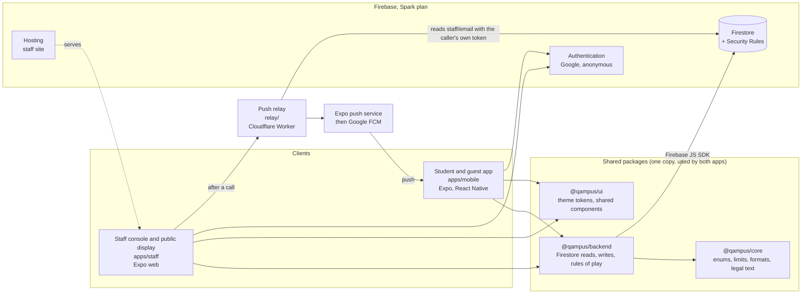
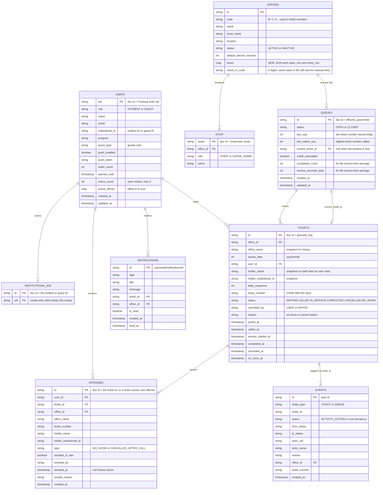
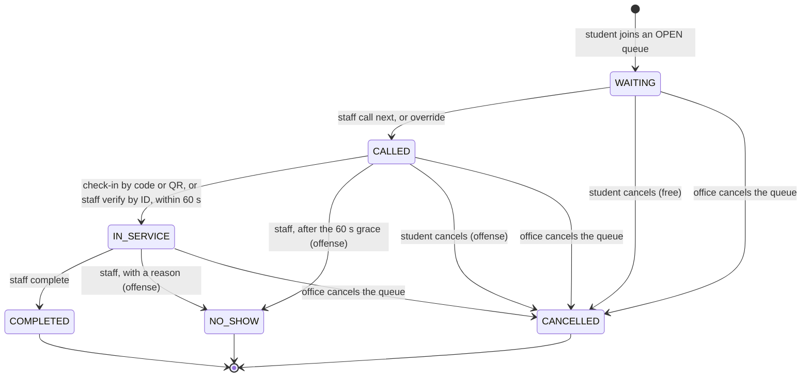
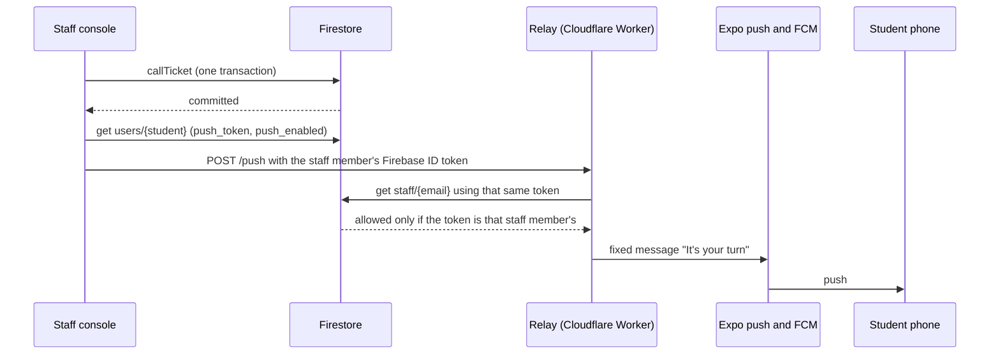

# QAMPUS architecture

How the system is built and why. Every statement here was checked against the code; file and function names are given so you can
verify it. For working agreements, current status and the decisions that still bind, see `MAINTAINERS.md`. The product spec is
`KnowledgeBase/QAMPUS_PRD.md` (the Technical Design Document's Express/Postgres design is superseded by this document).

## 1. What the system is

A campus queueing system. Students and guests take a numbered ticket for an office from their phone; office staff call tickets
from a web console; a public display shows who is being served; a student checks in on arrival, inside a 60-second grace period.
Missing the call or cancelling after it is an offense with escalating penalties.

There is **no application server**. The phone and the browser talk to Firebase directly. The Firestore Security Rules are the
backend's enforcement layer, and a shared client library (`packages/backend`) holds all business logic.



## 2. The stack and what it provides

| Piece | What it provides to this project | Where |
|---|---|---|
| **Firestore** | Live documents with listeners (`onSnapshot`), so every screen updates without polling; multi-document transactions and batches, so a ticket change, a queue change and a log line commit together or not at all. | `packages/backend` |
| **Firestore Security Rules** | The enforcement layer. Rules check who may write, which fields change, server time (`request.time`) and cross-document consistency (`getAfter`, `existsAfter`). With no server, this is what stops a modified client. | `firestore.rules` |
| **Firebase Authentication** | Google sign-in for students (school domain) and staff, and anonymous accounts for guests. The token carries the verified email that rules and the relay use. | each app's `lib/firebase.js` |
| **Spark plan** | Free tier: no billing card, no Cloud Functions. This is the reason the design is client-heavy and why a relay exists. | `firebase.json`, `.firebaserc` |
| **Firebase Hosting** | Serves the staff console at the `qampus-staff` site (single-page app rewrite). | `firebase.json` |
| **Expo and React Native** | One JavaScript codebase for the phone app (`apps/mobile`) and the staff web app (`apps/staff`, via `react-native-web`), sharing packages. Expo SDK 57, React 19, React Compiler on in the mobile app. | `apps/*` |
| **Expo Router** | File-based navigation. Route groups and `Stack.Protected` guards put screens behind session state. | `apps/*/src/app` |
| **EAS** | Cloud builds of the native Android app and over-the-air updates for JavaScript-only changes. | `apps/mobile/eas.json` |
| **Native modules** | `@react-native-google-signin` (sign-in), `expo-camera` (QR check-in), `expo-local-authentication` (biometric unlock), `expo-notifications` (push). These need a development build, not Expo Go. | `apps/mobile/app.json` |
| **npm workspaces** | One repository, one `node_modules`, three internal packages linked by name (`@qampus/backend`, `@qampus/core`, `@qampus/ui`). | root `package.json` |
| **Cloudflare Worker (relay)** | The one small server: it sends the "your turn" push, which the browser cannot do itself and Spark cannot host. Free plan. | `relay/` |

### Layering rules

- `@qampus/core` is pure JavaScript with no React and no Firebase: enums (`TICKET_STATUS`, `ACTIVITY_ACTION`, ...), limits
  (`RULES`), campus-day formatting, ticket-status derivation, the program catalogue and the legal text.
- `@qampus/backend` depends on `core` and on the Firebase SDK (as a peer dependency, so each app supplies its own `db`). Every
  function that touches Firestore takes `db` as its **first argument**; mobile and staff initialize Firebase for different
  platforms, so neither can import a ready-made instance.
- Inside `backend`, each feature (`ticketing`, `penalties`, `events`, `notifications`, `identity`) splits **pure** files (no
  Firebase, run and unit-tested under plain Node: `ids`, `derive`, `preflight`, `progress`, `offense`, `build`) from **Firestore**
  files (`data.js` listeners, `service.js` writes).
- Apps keep only screens, providers and thin hooks. No Firestore business logic lives in an app.

## 3. The two apps

### Student and guest app (`apps/mobile`)

Route groups under `src/app`: `(auth)` (login, onboarding, complete-profile, guest-profile), `(app)` with `(tabs)` (home, queue,
scan) and `(profile)` (profile, edit-profile, notifications, bans, settings, help), plus `legal/[doc]` reachable signed out.

Provider stack (`src/app/_layout.jsx`): `SafeAreaProvider` > `ThemeProvider` > `SessionProvider` > `BiometricProvider` >
`QueueDataProvider`.

- `SessionProvider`: who is signed in. A Google student is checked against the school domain (`tip.edu.ph`); an anonymous account
  is a guest. Loads or creates `users/{uid}`. A profile without a student ID and program (or, for a guest, name and type) sends
  the user to the profile form.
- `QueueDataProvider`: **one set of Firestore listeners for the whole app**: all offices with today's queue per office
  (`watchBoard`), the user's tickets, offenses, profile and notifications. Hooks (`useOffices`, `useMyTickets`, `useJoinQueue`,
  `useCancelTicket`, `useCheckIn`, `usePenaltyRecord`, `useNotifications`) read from it, so screens never open their own listener.
  The listeners restart at midnight campus time because the queue document id contains the date.
- `BiometricProvider` and `LockScreen`: an optional lock (per device, default off) after a cold start or more than a minute in the
  background. It gates the screen only.
- The signed-in layout hosts the app-wide `CalledModal` ("It's your turn" with the countdown).

### Staff console and public display (`apps/staff`)

Routes: `sign-in`, `not-assigned`, `(console)` (queue, offenses, activity-log), `display/[code]` and `legal/[doc]`. The display and
legal pages are outside the `Stack.Protected` blocks, so they open with any session or none.

Provider stack: `ThemeProvider` > `SessionProvider` > `OfficeProvider` > `QueueProvider`.

- `SessionProvider`: Google popup, then `staff/{email}` lookup for `office_id`, `role`, `name`. **The document is the access
  control.** No document means Not Assigned. There is no domain check. Anonymous accounts are ignored (they belong to the display).
- `OfficeProvider`: the live listener on the staff member's own `offices/{office_id}`.
- `QueueProvider`: the live queue, tickets and offenses of that office; wraps every staff action (open, close, call next,
  override, verify, complete, no-show, cancel queue, revoke, cutoff override) and turns refusals into readable banners.
- Public display (`display/[code]`): looks up the office by code, shows Now Serving, the next three numbers, the check-in QR and
  manual code. It reuses the browser's session if there is one (a tab opened from the console), otherwise signs in anonymously
  (a counter TV). It shows numbers only, never names.

## 4. Data model

Everything is a Firestore document. Timestamps are written as server time and the rules require them to equal `request.time`.
Ids are chosen so that **rules can find documents by path**: rules cannot run queries.



Offices and staff are **seeded by hand** in the Firebase console; no client can write them. There is no `announcements`
collection yet.

### Why the model looks like this

- **One queue document per office per campus day** (`officeId_yyyymmdd`, campus time is UTC+8). A new day starts with no document,
  which means "closed"; staff create it by pressing Open queue. Students never create queue documents.
- **The ticket id is `queueId_seq`, and tickets are create-only.** The next number is `last_seq + 1`, and the join writes the queue
  bump and the ticket together, so two students can never hold the same number: the second write fails and retries.
- **Tickets carry `user_id` and a snapshot of the holder** (`holder_name`, `holder_institutional_id`, `office_name`). Staff cannot
  read other users' profiles, and rules cannot query for a ticket's owner, so the data staff need is copied onto the ticket.
- **Derived values are not stored**: position, people ahead, waiting count, estimated wait, the short number (`R-003`).
  Position is `daily_sequence - last_called_seq`; waiting is about `last_seq - last_called_seq` (a cancelled ticket counts until
  called past: an accepted approximation). See `ticketing/derive.js`.
- **`users.active_count` and `users.active_offices`** exist because rules cannot count or query. Both live on the student's own
  document at a known path, are raised by a join in the same write as the ticket, and are lowered by every write that ends a
  ticket (`releaseHolder` in `ticketing/service.js`).
- **`offenses/{ticketId}` shares the ticket's id**, so a ticket causes at most one offense and rules can find it with
  `existsAfter`. It is a separate collection because it has its own lifecycle (revoke, Bans & Warnings list, staff Offenses screen)
  and keeps penalty fields off the ticket the student owns.
- **`institutionalIds/{id}`** is a create-only claim `{ uid }`. Creating it in the same write that saves the ID on the profile is
  what makes student and guest IDs unique without a server.
- **`events`** is an activity log written inside the transaction of the action it describes. It was chosen over deriving the log
  from tickets because tickets keep no staff actor and no queue-level actions (open, close, cancel, cutoff override).
- **`users/{uid}/notifications`** is a mailbox: each notification is one more write inside the transaction that causes it.
- **Office timezone** is one campus constant (UTC+8) in the rules and the apps, not a field.

## 5. The ticket lifecycle



"Expired" is not a stored state: it is derived as `called_at + 60 s` already past (`toTicketStatus` in `core/ticket.js`).

| Transition | Who | Function (`packages/backend/src/ticketing/service.js`) | One atomic write contains |
|---|---|---|---|
| open / close queue | staff | `openQueue`, `closeQueue` | queue doc, log line |
| join | student | `joinQueue` | queue `last_seq`, new ticket, user counter and office map, log line, "queue joined" notification |
| call | staff | `callTicket`, `callNext` | ticket `CALLED`, queue `current_ticket_id` and `last_called_seq`, log line, "your turn" notification, optional "approaching" notification to the student 3rd in line |
| start service | student or staff | `checkInByCode`, `verifyByHolderId` | ticket `IN_SERVICE`, log line |
| complete | staff | `completeTicket` | ticket `COMPLETED`, queue window freed and visit counted with its length, holder released, log line |
| no-show | staff | `markTicketNoShow` | ticket `NO_SHOW`, window freed, holder released and strikes moved, offense, log line, notification |
| student cancel | student | `cancelOwnTicket` | WAITING: ticket, holder released. CALLED: also window freed, offense, strikes, warning notification |
| office cancels queue | staff | `cancelOfficeQueue` | closes the queue and cancels the ticket at the window in one transaction, then the waiting tickets in groups of three |

Why the **window** (`queues.current_ticket_id`) exists: it is how one counter serves one ticket at a time. Calling requires it to
be null; every way a ticket leaves the window clears it in the same write. Two staff pressing Call next at once cannot call two
tickets, because the second transaction sees the first one's write and the rules reject it.

### Order inside a transaction

Firestore transactions require all reads before any write, so each service function reads the documents it needs (queue, ticket,
user), runs the pure `preflight` check for a readable refusal, then writes. The events and notification writes go last.

### Preflight versus rules

`preflight.js` (pure) gives the UI a readable reason (`TicketingError`: `QUEUE_CLOSED`, `BANNED`, `LIMIT_REACHED`, ...). The Security
Rules enforce the same conditions again, authoritatively. A client that skips preflight is stopped by the rules; a client that
passes preflight can still be refused by the rules, and the refusal arrives as `DENIED`.

## 6. Business rules and where each is enforced

| Rule | Behaviour | Enforced by |
|---|---|---|
| Grace period | A called student has 60 s to start service; staff cannot mark a no-show before 60 s have passed. | **Rules** (`validArrival`, `validFinish`, server time) and preflight |
| Three active tickets | A student holds at most three tickets in WAITING, CALLED or IN_SERVICE across all offices. | **Rules** (join requires `active_count < 3` and the counter raised by exactly one) and preflight. A modified client could lower its own counter: accepted. |
| One ticket per office | A student cannot join an office where they already hold an active ticket. | **Rules** (`active_offices`) and preflight. Same limitation as above. |
| Open queue only | Joins need today's queue OPEN; the ticket must take exactly the next number. | **Rules** (`validJoin` with `getAfter` on the queue) |
| Offenses | A no-show, or cancelling after being called, creates an offense. Office and system cancellations never do. | **Rules**: a CALLED cancel or a no-show is refused unless the offense is created in the same write. |
| Strikes and ban | First offense: one strike. Second: strikes reset to 0 and a 24-hour ban. A ban blocks joining only. | **Rules** (`penaltyMoveOk`, `banWindow`, `validOffense`) and `penalties/progress.js`. The ban end is written by the app; rules accept it within half an hour of `request.time + 24 h`, because rules cannot add 24 hours to server time. |
| Revoke | Staff of the offense's office revoke it with a reason; the record stays. Revoking the offense that caused a ban lifts it and sets strikes to 1; any other lowers strikes by 1. | **Rules** (`validRevoke`, `revokeMoveOk`), `revokeEffect` |
| Unique IDs | No two accounts share a student ID or guest ID. | **Rules** (`institutionalIds` claim created with the profile) |
| Capacity cutoff | A join is refused when the minutes left before closing, divided by the average visit, are fewer than the people waiting plus one. Staff can override for the day. | **Client only** (`cutoffState`, checked in `joinQueue` and by the Join button). Rules only let staff set `cutoff_overridden`. |
| Wait estimate | People ahead times the average visit. The average is today's measured one after at least 3 completed visits (never below 1 minute), otherwise the office default. | Client (`averageServiceMinutes`) |
| Staff fenced to office | Staff act only on their own office's queue, tickets and offenses. | **Rules** (`staffOfficeId()` on every staff clause) |

The numbers (60 seconds, 3 tickets, 2 offenses, 24 hours, place 3, 3 visits, 1 minute) live in `RULES` in `core/src/domain.js` and
feed both the code and the user-facing text.

## 7. Security and trust model

**Student and guest clients are treated as hostile; assigned staff are trusted but fenced to their office.** Anyone can read the
public API key out of the app, so the rules are the only real protection.

Rules by collection (`firestore.rules`):

| Collection | Read | Write |
|---|---|---|
| `users/{uid}` | the owner; staff may `get` one profile (never list) | create only as self, with counters at zero and the role matching the sign-in type; role never changes; counters move only within allowed steps |
| `staff/{email}` | only the person whose email is the document id | nobody |
| `offices` | any signed-in user | nobody (seeded by hand) |
| `queues` | any signed-in user | staff for their office (open, close, call, free the window, complete, cancel queue, cutoff override); a student only to take the next number together with their own new ticket, or to clear the window when cancelling their called ticket |
| `tickets` | the holder; staff of the ticket's office | each transition has its own validator (`validJoin`, `validCall`, `validArrival`, `validFinish`, `validCancel`, `validOfficeCancel`) fixing who, which fields, and what else must change in the same write |
| `offenses` | the holder; staff of the office | created only with the ticket change that causes it; updated only by staff, only to revoke |
| `events` | staff of the office | create-only, fixed fields, `actor_uid == request.auth.uid`, server time |
| `users/{uid}/notifications` | the owner | staff may create for any student; the owner only their own queue-confirmed and warning; the owner may only mark one read |
| `institutionalIds` | any signed-in user may `get` one | create-only, only together with the owner's profile carrying that id |

Key ideas:

- **Atomic cross-document checks.** `getAfter` and `existsAfter` let a rule look at the state a write will produce. That is how
  "the ticket becomes CALLED and, in the same write, the queue points at it" is enforced.
- **Server time everywhere.** Timestamps must equal `request.time`, so a client cannot backdate a call or extend a grace period.
- **Rules lookups are limited** (about 20 documents per write), so office-wide cancellation runs in groups of three tickets.
- **Staff gate.** `isStaff()` requires a verified email token and an existing `staff/{email}` document. The document is seeded by
  hand; only seed emails you trust.
- **Accepted weaknesses** (prototype scope; see `MAINTAINERS.md`): counters and the activity log can be falsified by a hand-made
  client; the cutoff is client-side; the repository is public and anonymous sign-in is enabled, so strangers can create guest
  accounts. The Firebase API keys in the repo are public client configuration by design; no private key, service account or token is
  in the tree or history.

### Sign-in paths

- **Student:** native Google sign-in yields an ID token, then Firebase `signInWithCredential`. The school-domain check runs in
  `SessionProvider`, and the rules require a verified `@tip.edu.ph` email to create a STUDENT profile.
- **Guest:** `signInAnonymously` plus one transaction that reserves a unique `G` + six digits ID and creates the profile
  (`issueGuestProfile`). The account is made only when the guest form's Continue succeeds, and is deleted again if any part fails.
  The ID is generated in the app because there is no server; uniqueness is enforced by the rules.
- **Staff:** Google popup, then the `staff/{email}` lookup.

## 8. Notifications

Two separate channels:

1. **In-app mailbox** (`users/{uid}/notifications`). Written in the transaction of the change that causes it: queue joined, your
   turn, approaching (3rd in line), no-show, queue cancelled, offense revoked, warning on a called cancel. Text is built by the
   pure `buildNotification`. The mobile app shows a list and bell, marks items read only while the screen is focused, and slides a
   banner in for a new one while the app is open.
2. **Push** for "your turn" only, so a closed app still hears it.



Why a relay: the browser cannot call Expo's push API (no CORS), a closed app cannot wake itself, and Spark has no server. The relay
stores **no secret**: it proves the caller is staff by reading `staff/{email}` with the caller's own token, and Firestore's rules
validate that token. It sends only a fixed message (the only caller-supplied text is the office name), and browsers may call it only
from the origins in `ALLOWED_ORIGINS` (`relay/wrangler.jsonc`). The push is best effort: the staff console never lets a failed push
undo the call. Limits: Android only, delivery receipts are not processed.

## 9. Check-in

The office document holds a static six-digit `check_in_code`. The public display encodes it as `qampus://check-in/{officeCode}/{code}`
(`checkInPayload`), and the phone parses it back (`parseCheckInPayload`), so the two sides share one format. Scanning the QR and
typing the digits run the same `checkInByCode` validation. The code is deliberately not secret (it is posted publicly); the real
safeguards are that only a CALLED ticket can start service, only within the 60 seconds, and that staff can mark a verified no-show.
Staff can instead verify by the holder's ID (`verifyByHolderId`).

## 10. Testing and quality

- **Unit tests** (`node --test`): `packages/backend/test` (85 tests) covers the pure logic: ids, derivations, preflight checks, the
  cutoff, penalties and revokes, notification text, event building, identity, check-in payloads, the display state and the program
  catalogue. `relay/test` (7 tests) covers origin checks, token parsing and the push message.
- **Security Rules are not unit tested.** There is no emulator in the workflow; rules were verified by testing the real flows on a
  phone and in a browser against the real Firebase project.
- **Lint**: `npm run lint` runs ESLint in both apps and the legal-text guard in `core`, which fails if a legal document's wording
  changed but its "Last updated" date did not (`npm run legal:accept` records a typo-only fix).
- **Manual testing**: each feature was tested on a physical Android device (student) and a browser (staff).

## 11. Repository map

| Path | What it is |
|---|---|
| `apps/mobile` | Student and guest app. `src/app` routes, `providers`, `hooks`, `components`, `lib` (firebase, push, biometric). |
| `apps/staff` | Staff console and public display. Same layout. |
| `packages/backend` | `@qampus/backend`. `ticketing/`, `penalties/`, `events/`, `notifications/`, `identity/`, `plain.js`; `test/`. |
| `packages/core` | `@qampus/core`. `domain.js`, `format.js`, `ticket.js`, `programs.js`, `legal.js`, `scripts/check-legal.mjs`. |
| `packages/ui` | `@qampus/ui`. Theme tokens, `ThemeProvider`, shared primitives. |
| `relay/` | Cloudflare Worker for push. Outside the npm workspaces. |
| `firestore.rules`, `firestore.indexes.json` | The database's source of truth. |
| `firebase.json`, `.firebaserc` | Rules, indexes and Hosting config, pinned to project `qampus-d0718`. |
| `KnowledgeBase/` | Product spec (PRD), UI/UX docs and the superseded TDD. |
| `docs/` | This document and `MAINTAINERS.md`. |

## 12. Running and deploying

```bash
npm install
npm run staff                                              # staff web console, port 8081
cd apps/mobile && npx expo start --dev-client --tunnel     # student app, in the development build on a phone
cd packages/backend && npm test                            # unit tests
npm run lint                                               # both apps and the legal guard
```

- **Rules and indexes:** `firebase deploy --only firestore:rules,firestore:indexes --project qampus-d0718`. A deploy replaces the
  whole ruleset; never edit rules in the console.
- **Staff site:** `npx expo export --platform web` in `apps/staff`, then `firebase deploy --only hosting --project qampus-d0718`.
- **Mobile:** native changes need `eas build --profile development` (from `apps/mobile`); JavaScript-only changes reload, or ship
  with `eas update`.
- **Relay:** `npm run deploy` in `relay/`. After changing `ALLOWED_ORIGINS`, redeploy it.
- Each app reads its Firebase config from its own `.env` (`EXPO_PUBLIC_FIREBASE_*`); these are public client settings.
