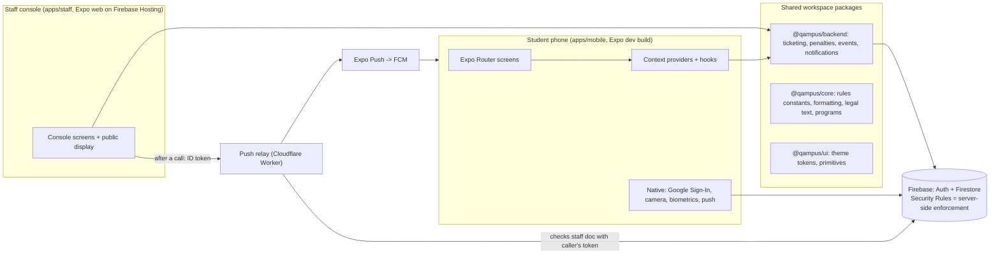
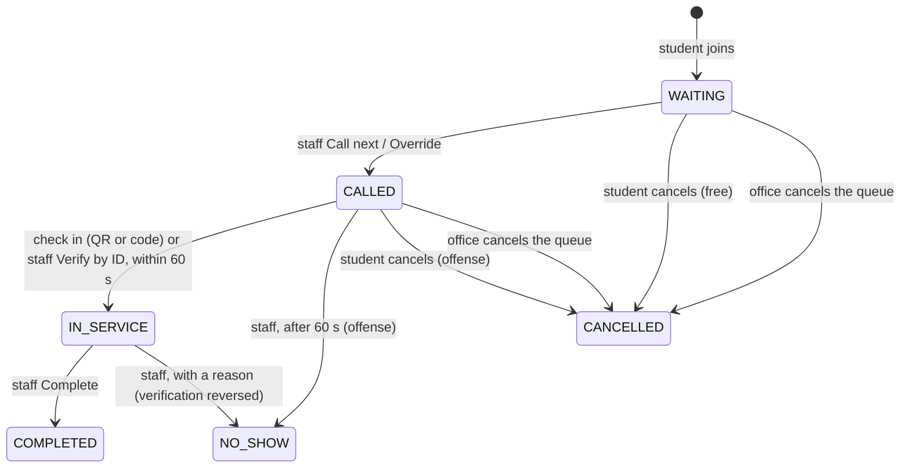

# QAMPUS Defense Reference Guide

Study guide for the 10-minute presentation and the 5-minute technical defense. Focus: **System Design (section 2)**, **Technical Deep Dive (section 4)**, and **Accessibility decisions**.
Everything here comes from the repo (code, `docs/DECISIONS.md`, `docs/SCHEMA.md`, `KnowledgeBase/`). Where I could not verify something, it says so. File paths are real; open them before the defense.

## Contents
1. [30-second pitch and key numbers](#1-30-second-pitch-and-key-numbers)
2. [System design](#2-system-design)
3. [Technical deep dive](#3-technical-deep-dive)
4. [Accessibility and UX decisions](#4-accessibility-and-ux-decisions)
5. [Honest limits and trade-offs](#5-honest-limits-and-trade-offs)
6. [Code-walk map (files to open in the IDE)](#6-code-walk-map)
7. [Likely questions with model answers](#7-likely-questions-with-model-answers)
8. [Do not say / be careful](#8-do-not-say--be-careful)

---

## 1. 30-second pitch and key numbers

**QAMPUS** is a digital queue for school offices (Registrar and others). Students join a queue from their phone instead of standing in a physical line. Staff run the window from a web console. A public display shows who is being served.

**Problem:** physical lines waste students' time, give no wait information, and have no fair, auditable order or penalty for no-shows.
**Objectives:** fair FIFO order, live status, no-show accountability (strikes and 24 h ban), and a staff audit trail.

| Number | Value | Where |
|---|---|---|
| Grace period to check in after being called | 60 s | `RULES.GRACE_PERIOD_SECONDS` (`packages/core/src/domain.js`) |
| Max active tickets per student | 3 | `RULES.MAX_ACTIVE_TICKETS` |
| Active tickets per office | 1 | `users.active_offices` |
| Offenses per ban | 2 (first = strike, second = 24 h ban) | `RULES.OFFENSES_PER_BAN`, `BAN_HOURS` |
| "Approaching turn" notice | 3 places back | `RULES.APPROACHING_PLACE` |
| Measured wait time starts after | 3 completed visits, 1 min floor | `MIN_MEASURED_VISITS`, `MIN_VISIT_MINUTES` |
| Minimum tap target | 48 dp, 8 dp apart | `TOUCH.MIN_TARGET` (`apps/mobile/src/constants/theme.js`) |
| Campus time | UTC+8 constant | `campusDate` in `@qampus/core/format` |
| Firebase project | `qampus-d0718`, Spark (free) plan | `.firebaserc` |
| Stack versions | Expo SDK 57, React Native 0.86.3, React 19.2.3, Firebase JS SDK 13 | `apps/mobile/package.json` |

---

## 2. System design

### 2.1 Architecture (say this in 90 seconds)

**Talking points**
- **Monorepo, three apps plus shared packages.** One `@qampus/backend` layer is used by both apps (every function takes `db` first so mobile and web inject their own Firestore). One copy of the business rules.
- **No custom server.** Firebase Spark plan only (a cost decision, 2026-10-23). So the "backend" is **Firestore Security Rules plus the shared client service layer**. The rules are the real enforcement; the client code only gives readable error messages.
- **Realtime by listeners, not polling.** Firestore `onSnapshot` listeners feed the UI, so the staff console, the display and the phone update together.
- **A small relay exists only because push needs a trusted sender.** Cloud Functions need the paid Blaze plan, and the staff web page cannot call Expo's push API (CORS), so a free Cloudflare Worker sends the push after verifying the caller is staff.

### 2.2 Data model (ERD)
Full diagram with every field: `docs/SCHEMA.md` (open it on screen for the ERD slide). Summary:

| Collection | Doc id | Purpose |
|---|---|---|
| `users` | Auth uid | Student or guest profile, strikes, ban, `active_count`, `active_offices`, push token |
| `institutionalIds` | the student/guest ID | Create-only claim so IDs are unique |
| `offices` | office id | Code, hours, default visit minutes, `check_in_code` |
| `staff` | lowercase email | `office_id`, role. **This doc is the staff access gate** |
| `queues` | `{officeId}_{yyyymmdd}` | One per office per day: status, `last_seq`, `last_called_seq`, `current_ticket_id` |
| `tickets` | `{queueId}_{seq}` | One per join, with a status and one timestamp per status |
| `offenses` | same id as the ticket | Penalty record (separate collection, own lifecycle: revoke) |
| `events` | auto id | Activity log, create-only, written in the same transaction as the action |
| `users/{uid}/notifications` | auto id | The student's in-app mailbox |

**Design choices you can defend**
- **Queue doc id includes the date**, so every day starts clean and a join can only target today's queue.
- **Ticket id = queue id + sequence number, create-only**, so two students can never get the same number.
- **Derived values are not stored** (position, people ahead, estimated wait, short ticket number). They are computed on the client from the queue counters (`packages/backend/src/ticketing/derive.js`). Less to keep consistent.
- **Snapshots on tickets/offenses** (`holder_name`, `office_name`): staff cannot read other users' profiles, so the ticket carries what they need.
- **Offenses are a separate collection** with the same id as the ticket, so one ticket causes at most one offense.
- **Ticket status and timestamp are one-to-one** (`WAITING -> joined_at`, `CALLED -> called_at`, and so on).

### 2.3 Ticket lifecycle (state machine)

"Expired" is derived (`called_at + 60 s`), not stored.

### 2.4 UI/UX flow (what to show)

**Student (mobile):** Onboarding -> Login (Google, school domain only, or Continue as guest) -> Complete profile -> **Home** (active tickets) / **Queue** (offices list, join) / **Scan** (check in) -> Profile (Settings, Bans & Warnings, Notifications, Help, Legal).
**Staff (web):** Sign-in (Google, `staff/{email}` doc) -> **Queue** (open/close, call next, verify, complete, no-show, cancel queue, launch display) -> **Offenses** (revoke) -> **Activity Log** (filters, 50 per page).
**Public display:** `/display/{office code}`: Now Serving, next three, QR and manual code. No names (public screen).

Design basis: `KnowledgeBase/QAMPUS_PRD.md` (requirements R-xx), `QAMPUS_UIUX.md` (screens, states, accessibility), Figma prototype. Gold-and-Ink theme, DM Sans type.

### 2.5 Why these decisions (the "justify your choice" answers)
| Decision | Reason | Cost you accept |
|---|---|---|
| Firebase over Express/Postgres | Realtime listeners built in, free tier, no server to run, the school project has no budget | Logic lives in Security Rules and the client; no server-side transactions beyond the client SDK; rule lookup limits |
| Stay on Spark, no Cloud Functions | Avoid a billing card | Needed a push relay; counters enforced by rules, not by server code |
| Shared `@qampus/backend` | One implementation for mobile and staff; pure parts unit tested (`npm test`) | Monorepo setup complexity |
| Staff open the queue manually | A scheduled open does nothing if nobody is at the counter | Hours are display only |
| `check_in_code` on the office doc | One 6-digit value for QR and manual entry; fewer collections | A photo of the QR can be shared; staff no-show covers abuse |
| Guest = anonymous Firebase account | No credentials needed; bound to the device | Reinstalling creates a new guest and ID |

---

## 3. Technical deep dive

### 3.1 React Native technologies used
Expo SDK 57 (dev build, not Expo Go), React Native 0.86, React 19. The app code is **JavaScript** (`.jsx`, `jsconfig.json`), not TypeScript.

| Library | Used for |
|---|---|
| `expo-router` | File-based navigation |
| `firebase` (JS SDK) | Auth, Firestore listeners and transactions |
| `@react-native-google-signin/google-signin` | Native Google account picker, yields an ID token |
| `expo-camera` | QR scan on the Scan tab |
| `expo-local-authentication` | Biometric unlock |
| `expo-notifications`, `expo-device` | Push token, Android channel, permission |
| `@react-native-async-storage/async-storage` | Firebase session persistence, onboarding flag, theme, biometric setting |
| `react-native-reanimated`, `gesture-handler`, `safe-area-context`, `screens` | Animation, gestures, insets, native screens |
| `expo-updates`, EAS | Dev builds and over-the-air JS updates |
| `expo-font` + `@expo-google-fonts/dm-sans` | Typography |

### 3.2 Navigation structure
- **Expo Router, file-based.** Routes live in `apps/mobile/src/app/`. Groups: `(auth)` (login, onboarding, complete-profile, guest-profile) and `(app)` containing `(tabs)` (home, queue, scan) and `(profile)` (profile, settings, notifications, bans, edit-profile, help). `legal/[doc]` sits outside both groups so Login can open it signed out. `[doc]` is a dynamic route.
- **Entry gate:** `app/index.jsx` waits for `authReady`, then `Redirect`s: signed in with an incomplete profile -> profile form; signed in -> `/home`; else onboarding or login.
- **Custom bottom bar, not a tab navigator.** `(app)/_layout.jsx` renders one `BottomNav` floating over a `Stack`. Pages slide in beneath the bar, which never moves (matches the Figma design).
- **App-wide overlays in that layout:** the "It's your turn" `CalledModal` and the notification banner. They are suppressed while the biometric lock is on.
- **Staff web** uses `Stack.Protected` blocks so a route exists only in its session state (signed out, signed in without an office, console).

### 3.3 State management
**No Redux/Zustand. React Context + hooks + Firestore listeners.**
- Provider order in `app/_layout.jsx`: `ThemeProvider` -> `SessionProvider` -> `BiometricProvider` -> `QueueDataProvider`.
- **`SessionProvider`**: who is signed in (student via Google, guest via anonymous Auth), profile completeness, onboarding flag. Uses `onAuthStateChanged` and a `signingIn` ref so the listener does not load the profile twice.
- **`QueueDataProvider`**: the single set of live listeners for the app: `watchBoard` (offices + today's queues), `watchMyTickets`, `watchMyOffenses`, `watchProfile`, `watchMyNotifications`. Each `useEffect` returns the unsubscribe function. The board listener restarts when the campus day rolls over (`dayKey` checked every minute).
- **Hooks are thin adapters** that derive views: `useMyTickets` (active vs history, position, countdown), `useOffices`, `useJoinQueue`, `useCheckIn`, `usePushRegistration`, and so on.
- **Why Context, not Redux:** the data is server state that Firestore already keeps live; the app has few independent stores; a store library would duplicate what listeners already provide. `useMemo` keeps context values stable.
- **Local UI state** stays in components (`useState`). **Per-device preferences** go to AsyncStorage (theme, onboarding flag, biometric setting), never Firestore.
- **A one-second timer runs only while a ticket is CALLED** (`useNow(1000, hasCalled)`), so countdowns are live without constant re-rendering.

### 3.4 Backend integration (Firebase)
- `apps/mobile/src/lib/firebase.js`: `initializeApp` from `EXPO_PUBLIC_*` env vars, `initializeAuth` with `getReactNativePersistence(AsyncStorage)` so users stay signed in; guarded for fast refresh (`initializeAuth` throws if called twice).
- **Google sign-in flow:** native picker -> ID token -> `signInWithCredential`. The school domain (`tip.edu.ph`) is checked in the app and again by the Firestore rules (`schoolEmail()`).
- **Layered backend code** (`packages/backend/src/<feature>/`): `service.js` (writes), `data.js` (listeners/reads), `preflight.js`/`derive.js`/`ids.js` (pure, no Firebase, unit tested). 16 test files in `packages/backend/test`.
- **Writes are transactions or batches** that change several documents atomically.

**Join, in one transaction (`joinQueue`, `packages/backend/src/ticketing/service.js`):**
1. Read the queue, the user's profile and the office.
2. `checkJoin` (pure): profile complete, not banned, office active, not already in this office, under 3 tickets, queue OPEN, before the cutoff.
3. Write: bump `queues.last_seq`, set `users.active_count` and `active_offices`, create the ticket, write an `events` line and a notification.
The ticket id contains the sequence number and is create-only, so if two students race, one transaction fails and retries.

**Security Rules (`firestore.rules`) are the enforcement.** They:
- fix who may change which fields and when (`validCall`, `validArrival`, `validFinish`, `validCancel`, `validOfficeCancel`, `validJoin`);
- tie a ticket change to the queue and user changes in the same write with `getAfter`/`existsAfter`;
- use `request.time` for the 60 s grace period, never the client clock;
- make a no-show or called-cancel impossible without the offense being created in the same write.

### 3.5 Asynchronous data, errors and loading
- **Listeners:** every `watch*` takes an `onError` callback; the provider logs with `warn(label)`. Signed out means every value falls back to a frozen empty constant, so a previous user's data never shows.
- **Typed failures:** `TicketingFailure` carries a `TicketingError` code (`QUEUE_CLOSED`, `BANNED`, `LIMIT_REACHED`, `GRACE_EXPIRED`, ...). `asFailure` maps Firestore `permission-denied` to `DENIED`; the UI maps codes to plain-language messages. Pure `check*` functions give a readable reason before the write; the rules re-check.
- **Sign-in cleanup:** a failed Google sign-in signs out of Firebase and Google; a guest account created during a failed profile save is deleted again (`completeGuestProfile`).
- **Loading:** the splash screen is held (`SplashScreen.preventAutoHideAsync`) until fonts load; `authReady` waits for Firebase and the saved onboarding flag so there is no flash of Login.
- **Best-effort side effects:** push registration and sending never throw into the main flow.

### 3.6 Native device features and permissions
| Feature | How | Permission and failure handling |
|---|---|---|
| **Google Sign-In** | Native library, `hasPlayServices()`, `hostedDomain` hint | Wrong-domain account is signed out and refused |
| **Camera / QR** | `expo-camera` `CameraView`, `useCameraPermissions`; plugin text in `app.json` | Camera runs only while the tab is focused and no dialog is open; first valid read locks scanning; denied -> "Allow camera" or "Open settings" (`Linking.openSettings`); typed 6-digit code always works. QR format in one place (`checkin.js`) |
| **Biometrics** | `expo-local-authentication` in `BiometricProvider`; setting in AsyncStorage per account | Locks on cold start and after 60 s in background; device PIN allowed as fallback; if the phone can no longer authenticate, the setting turns itself off so nobody is locked out |
| **Push notifications** | `expo-notifications`: create Android channel first, ask permission, `getExpoPushTokenAsync`, save token on the profile | Channel must exist before the token request or Android 13 never prompts; skipped on emulators (`Device.isDevice`); sign-out clears the token; foreground handler shows nothing (the in-app banner and dialog already announce it) |
| **AsyncStorage** | Auth persistence, onboarding, theme, biometric | Reads wrapped in `.catch`, never block the app |
| **Safe area / system UI** | `react-native-safe-area-context`, `expo-system-ui` | Bottom nav lifts above gesture bar or buttons (`useBottomNavClearance`) |

**Push path:** staff Call -> console reads the student's token -> POST to relay with the staff's Firebase ID token -> relay verifies it by reading `staff/{email}` over Firestore's web API with that token (rules decide) -> sends fixed "It's your turn" message via Expo -> FCM -> phone. The relay stores no secret and only accepts listed origins (`relay/wrangler.jsonc`).

### 3.7 Theming and shared UI
`@qampus/ui` holds tokens (colors, spacing, typography, radii), `ThemeProvider` (light/dark/system, optional storage) and primitives (`Button`, `Toggle`, `Input`). Mobile and web share them. Color tokens are semantic (`ink`, `paper`, `gold`, `onGold`), with separate light and dark sets, so components never hard-code colors.

### 3.8 Testing and tooling
- `npm test` in `packages/backend` runs node's built-in test runner over the pure logic (join checks, call, check-in, cutoff, penalties, events, notifications, identity).
- `npx expo lint`, `npx tsc --noEmit` (per `AGENTS.md`); `npm run lint` at root also runs the legal-text date check.
- **Not tested automatically:** Security Rules (no emulator, decided 2026-10-24; verified by hand on device and browser).
- EAS dev builds for native changes; `eas update` for JS-only changes.

---

## 4. Accessibility and UX decisions

Source: PRD R-31, `KnowledgeBase/QAMPUS_UIUX.md` section 11, and the decisions log (2026-10-25 "Thumb-friendly sizes", 2026-10-26 "Scan screen").

| Area | Decision | Evidence in code |
|---|---|---|
| **Touch targets** | Every tappable item at least 48 dp with 8 dp between neighbours (meets Material 48 dp, Apple 44 pt, WCAG 2.2 target-size AA 24 px). A small drawn icon is fine if padding makes the hit area 48 dp | `TOUCH.MIN_TARGET`; `Button` small size is 32 dp drawn with `hitSlop` 8 on each side; header bell and avatar 48 dp; menu rows at least 56 dp; nav tabs 48 dp |
| **Reach, not layout** | "Thumb zone" diagrams are a heuristic, so nothing was moved. Sizes, padding and insets were adjusted; the floating nav clears the system buttons or gesture bar | `useBottomNavClearance()` |
| **Status never by color alone** | Every ticket state pairs an icon and a text label with its color (Waiting = clock, Your turn = bell, No-show = person-remove...) | `buildStatusTheme` in `constants/theme.js` |
| **Contrast** | Gold-and-Ink palette. Ratios I computed from the tokens (WCAG needs 4.5 for body text): Ink on Paper 18.5, Ink on Gold 12.7, Slate on Paper 4.97, Error on Paper 6.1, White on Success 5.05; dark mode Ink 16.3, Slate 7.1, Error 6.2, Success 7.8 | `packages/ui/src/tokens.js` |
| **Light, dark and system theme** | Choice saved on the device; "follow device" stores nothing; no light flash while pages slide (native root view color set) | `ThemeProvider`, `SystemUI.setBackgroundColorAsync` |
| **Screen reader semantics** | `accessibilityRole` and `accessibilityLabel`/`State` on buttons (disabled state), tabs (selected), switches (checked), headers; modals mark `accessibilityViewIsModal` | `Button.jsx`, `BottomNav.jsx`, `Toggle.jsx`, `ModalShell.jsx`, `StaffModal.jsx` |
| **Alternative to QR** | Manual 6-digit code for students; ID number for staff verify; camera denial has a recovery path | `scan.jsx`, `useCheckIn` |
| **Biometric fallback** | Device PIN accepted; the setting disables itself if the phone has nothing left to ask | `BiometricProvider` |
| **Font scaling** | The Scan screen computes its layout from height, insets and font scale (capped at 1.3x) so text cannot overlap on short or zoomed phones | `scan.jsx` (the only file using `maxFontSizeMultiplier`/`allowFontScaling`) |
| **Plain, non-punitive copy** | Warnings, bans and errors use plain language; refusals say why ("Couldn't X. Reason") | Notification text in pure `buildNotification`; staff refusal banner |
| **Public display** | Large type for distance (Now Serving 160+, next three 64+), no names (privacy), closed and outage states | `QAMPUS_UIUX.md` section 3 |
| **Staff console (design target)** | Keyboard operable, focus ring, modals trap focus and close on Escape. **Verify before claiming this: the code shows `aria-modal` and `accessibilityViewIsModal`; I did not confirm the Escape key or focus trap.** | `StaffModal.jsx` |
| **Responsiveness** | Staff console works down to 360 px with a two-row top bar | Decision 2026-10-26 |
| **Auto-notifications** | Banner is subtle, 5 s, only for recent items, never over the lock screen or the screen it duplicates | `useNotificationToast` |
| **Language and legal** | In-app Terms and Privacy (RA 10173), reachable signed out | `legal/[doc].jsx` |

**Honest gaps to admit (and the plan):** no global font-scale cap in shared components (only Scan), contrast not audited for every status badge combination (opacity tints), staff keyboard behavior not formally tested, no screen-reader pass done. Say: "We designed for it and applied it where the risk was highest; a full audit with TalkBack is the next step."

---

## 5. Honest limits and trade-offs
Say these before the panel finds them; owning them reads as maturity.

| Limit | Why it exists | What a stronger version does |
|---|---|---|
| Three-ticket and one-per-office counters live on the user's own doc; a hand-made client could lower its own counter | Spark has no server; rules cannot see why a counter moved | Cloud Functions on Blaze, or the dropped `released_ticket` design |
| Capacity cutoff enforced in the client only | Rules cannot compute it cheaply | Server check |
| Repo is public with public client config (Firebase web key, OAuth client ids) | Client config is not secret by design; no private keys in tree or history (reviewed 2026-10-25) | Restrict API keys, enable App Check |
| Anonymous sign-in lets anyone with the public key create guest accounts | Guest feature requires it | App Check, rate limits |
| Any signed-in user could write a false `events` line | Create rules cannot verify the actor's role cheaply | Server-written log |
| `institutionalIds` readable by any signed-in user (so the app can see an ID is taken) | Uniqueness check from the client | Server-side issue |
| Check-in code is the same for everyone and visible on the display | Fallback to QR; PRD R-20 rejected a rolling QR | Rolling code |
| Push is Android-only, and only "your turn" | Prototype scope | iOS and more events |
| No automated Security Rules tests | Emulator was deferred | Emulator tests in CI |
| Records kept indefinitely; no in-app account deletion; consent not recorded | Prototype | Retention period, deletion step, DPO review |
| Waiting count is approximate (`last_seq - last_called_seq`) | Cancelled gaps and overrides overcount | Exact counter |

---

## 6. Code-walk map
Be able to open each and explain it in 30 seconds.

| # | File | What to say |
|---|---|---|
| 1 | `apps/mobile/src/app/_layout.jsx` | Provider order, fonts, splash hold, `Stack`, theme-synced native background |
| 2 | `apps/mobile/src/app/index.jsx` | Auth gate with `Redirect` |
| 3 | `apps/mobile/src/app/(app)/_layout.jsx` | Custom bottom nav over a Stack, `CalledModal`, toast, `usePushRegistration`, suppressed while locked |
| 4 | `apps/mobile/src/providers/SessionProvider.jsx` | Google sign-in, domain check, guest creation and cleanup, `signingIn` ref |
| 5 | `apps/mobile/src/providers/QueueDataProvider.jsx` | The listeners, unsubscribe on cleanup, day rollover, empty frozen defaults |
| 6 | `apps/mobile/src/hooks/useMyTickets.js` | Derive views with `useMemo`; timer only while CALLED |
| 7 | `packages/backend/src/ticketing/service.js` (`joinQueue`) | Transaction, preflight, atomic multi-doc write |
| 8 | `packages/backend/src/ticketing/preflight.js` and `derive.js` | Pure checks, error codes, cutoff and wait math |
| 9 | `firestore.rules` (`validJoin`, `validCall`, `validFinish`) | `getAfter`, `existsAfter`, `request.time` |
| 10 | `apps/mobile/src/lib/push.js` | Channel before token, permission, `Device.isDevice`, foreground handler |
| 11 | `apps/mobile/src/providers/BiometricProvider.jsx` | `AppState`, 60 s lock, PIN fallback, self-disable |
| 12 | `apps/mobile/src/app/(app)/(tabs)/scan.jsx` | Camera permission states, scan lock, manual fallback |
| 13 | `relay/src/` | Staff verification with the caller's own token, origin allow-list |
| 14 | `packages/ui/src/primitives/Button.jsx` | Sizes, `hitSlop`, accessibility props, themed styles |

---

## 7. Likely questions with model answers

### Architecture and design
**Q: Why Firebase and not a REST API with a database?**
Realtime listeners are built in, the free Spark plan fits a student project, and there is no server to deploy. The cost is that business rules live in Security Rules and the client. We documented that trade-off on 2026-10-22 and 2026-10-23.

**Q: If the client is hostile, how do you protect the queue?**
Security Rules. They check who may write which fields, use `request.time` for the 60-second window, and tie related writes together with `getAfter`/`existsAfter` (a no-show cannot happen without its offense). The client's `preflight` only produces friendly messages.

**Q: Why a monorepo with shared packages?**
Mobile and staff must apply identical rules. `@qampus/backend` is the single implementation; each app injects its own `db`. Pure logic is unit tested without Firebase.

**Q: How do two students not get the same ticket number?**
The ticket id is `queueId_seq` and is create-only, and the join runs in a transaction that reads and bumps `last_seq`. A race makes one transaction retry or fail.

**Q: Why store position and wait time on the client instead of the database?**
They change with every queue action; storing them would mean updating many documents. They are derived from `last_seq`, `last_called_seq` and the average visit length.

**Q: Why is the offense its own collection?**
It has its own lifecycle (revoke, list screens), keeps penalty data out of the ticket the student owns, and the same id as the ticket guarantees one offense per ticket.

**Q: What is your scaling story?**
Honestly: one queue doc per office per day means writes to one office contend on that doc (Firestore handles about one sustained write per second per document), fine for a school window. Beyond that you would shard counters or move to server-side logic. Read cost is bounded by listeners per user.

### State management and navigation
**Q: Why Context instead of Redux?**
Our state is mostly server state kept live by Firestore listeners, so a store would duplicate it. Context with a few providers and `useMemo` is enough; hooks derive what screens need. If many unrelated screens mutated shared client state, I would add Zustand.

**Q: Does every context change re-render everything?**
Any consumer of `QueueDataProvider` re-renders when its value changes. Values are memoized, and listeners only set state when snapshots arrive. If it became a problem, split the context (tickets, notifications, board) or use selectors.

**Q: How does navigation know if the user is signed in?**
`SessionProvider` listens to `onAuthStateChanged`; `index.jsx` waits for `authReady` and redirects. The staff app uses `Stack.Protected` so unauthorized routes do not exist.

**Q: Why not Expo Router's Tabs?**
The design has a floating bar that stays still while pages slide beneath it, and profile pages show no active tab. A custom `BottomNav` over a `Stack` gives that exactly.

### Async, errors, permissions
**Q: How do you handle a Firestore listener failing?**
Each `watch*` has an error callback that logs it; the UI keeps the last good value or the frozen empty default. (Admit: there is no global retry or offline banner for the student app yet; the staff display has an Outage screen.)

**Q: What happens if the join fails?**
`checkJoin` returns a typed code before the write; if rules refuse anyway, `asFailure` converts `permission-denied` to `DENIED`. The UI shows a message from the code.

**Q: How do you handle camera permission being denied?**
`useCameraPermissions`; if denied and the OS will not ask again, the button opens system settings with `Linking.openSettings`; the typed code always works, so check-in never depends on the camera.

**Q: Why create the Android notification channel before asking for the token?**
Android 13 never shows the permission prompt if no channel exists. We create the channel, ask once, then get the Expo token.

**Q: Why does the foreground notification show nothing?**
The in-app dialog and banner already announce it; the handler returns `shouldShowBanner: false` to avoid a duplicate. (This also means a push may not appear while the app is open, which matters for demos.)

**Q: What stops biometric unlock from locking someone out?**
Device PIN is accepted, and if the phone cannot authenticate any more (biometrics removed) the setting switches itself off.

### Security and trust
**Q: Your keys are in a public repo. Is that a leak?**
Those are Firebase client identifiers, public by design and shipped inside every build; no private keys or tokens are in the tree or history (reviewed). Real protection is the rules; the recommended extra steps are API key restrictions and App Check.

**Q: Can a student cheat the 3-ticket limit?**
With a hand-made client, yes, by lowering their own counter, because Spark has no server to verify it. Accepted for the prototype and documented; the fix is server-side logic.

**Q: How does a person become staff?**
A `staff/{lowercase email}` doc names their office; rules let a user read only their own. The app does not check the domain for staff. The doc is the gate.

### Accessibility
**Q: What did you do for accessibility?**
48 dp targets with 8 dp spacing from one shared constant, icon plus label for every status (never color alone), computed contrast in both themes, accessibility roles and states on shared components, a manual-code alternative to QR, biometric PIN fallback, system-following dark mode, and a Scan layout that survives font scaling.

**Q: Did you test with a screen reader?**
Be honest: we applied roles and labels but have not run a full TalkBack audit; it is the next step.

**Q: Why 48 dp?**
Material and Android guidance; it also satisfies Apple's 44 pt and WCAG 2.2 target size. We kept small visual buttons by adding hit slop instead of enlarging them.

### Process
**Q: Why JavaScript and not TypeScript?**
Speed of iteration for the team; the project has TypeScript tooling installed and `tsc` in the checklist. Say plainly it is a trade-off and that shared pure logic has unit tests instead.

**Q: How did you test?**
Unit tests for the pure logic, and manual end-to-end tests on a real phone and the staff browser per slice. Security Rules were not tested automatically.

### Hard "what if" questions
| Question | Answer in one line |
|---|---|
| Two staff press Call next at once | Rules allow a call only when `current_ticket_id` is null and tie it to the queue write; one wins, the other is refused |
| A student closes the app after being called | Push reaches the phone; after 60 s staff can mark No-show; the offense is created in the same write |
| Phone clock is wrong | Rules use `request.time`; the countdown display uses device time but nothing is enforced by it |
| Staff cancels the whole queue | Small transactions, no penalties, every holder notified; rerun to finish if interrupted |
| Day changes while the app is open | `dayKey` timer restarts the board listener on the new queue id |

---

## 8. Do not say / be careful
- Do not say "secure" without "enforced by Security Rules, with known limits".
- Do not claim TypeScript, Redux, or Cloud Functions; none are used.
- Do not claim a completed accessibility audit or Escape/focus trapping on staff modals until verified.
- Do not claim Security Rules are automatically tested.
- Push: only "your turn", Android only; a push may not show while the app is in the foreground.
- Know your own part of the repo and be ready to open it. Contribution questions use the GitHub history; this guide does not cover them.
