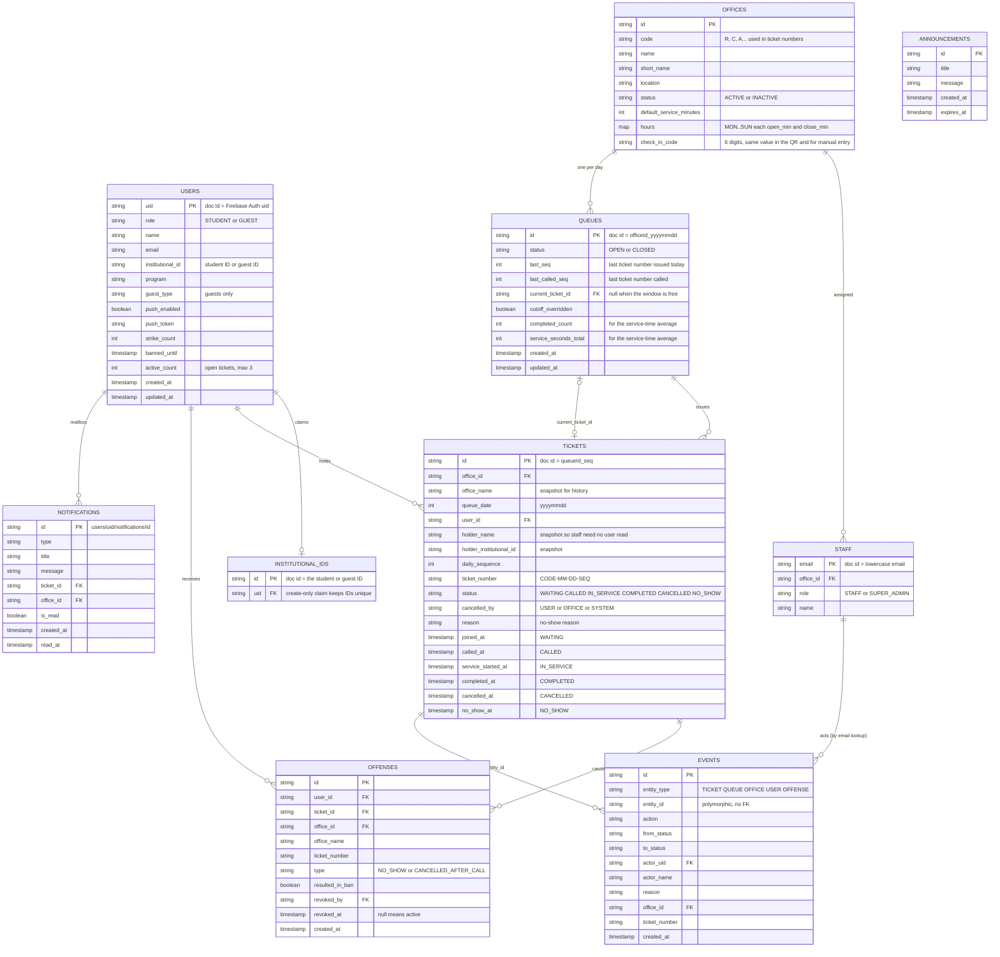

# Firestore schema (V1 draft)

Final shape for V1, locked one collection at a time. Locking a collection fixes its fields; seeding and implementation still happen per slice, not all at once.

| Collection | Status |
|---|---|
| `users` | **LOCKED** |
| everything else | draft |

Open items at the bottom.
Document IDs are in the comments. Everything is a Firestore document; `timestamp` fields must equal server time on write.

## Reading notes
- **Ticket state ↔ timestamp** is one to one: `WAITING→joined_at`, `CALLED→called_at`, `IN_SERVICE→service_started_at`, `COMPLETED→completed_at`, `CANCELLED→cancelled_at`, `NO_SHOW→no_show_at`. "Expired" is derived (`called_at + 60 s`), not stored.
- **Queue position** is derived on the client: `daily_sequence - last_called_seq`. Waiting ≈ `last_seq - last_called_seq`.
- **Not stored:** position, people ahead, estimated wait, short ticket number (`CODE-SEQ`).
- **Office timezone** is one campus constant (UTC+8) in the rules and the app, not a field.

## Which slice implements what
| Slice | Collections used |
|---|---|
| 1 Ticketing | `users` (profile), `offices`, `staff`, `queues`, `tickets` |
| 2 Penalties | `offenses`, strike and ban fields on `users`, `events` |
| 3 Limits and capacity | `active_count`, queue service totals, office hours checks |
| 4 Notifications | `notifications`, `announcements`, push token fields |
| 5 Guests | `institutionalIds` claims for guests, anonymous `users` |

## Open items
1. Keep the office `short_name`? (UI uses it a lot.)
2. Push needs a place for the holder's token on the ticket; depends on the push option (relay or in-app only).
3. `announcements` as a shared collection merged into the notification list (no server can fan out writes).
