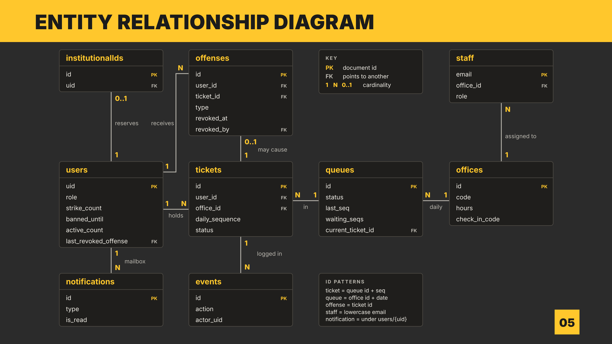
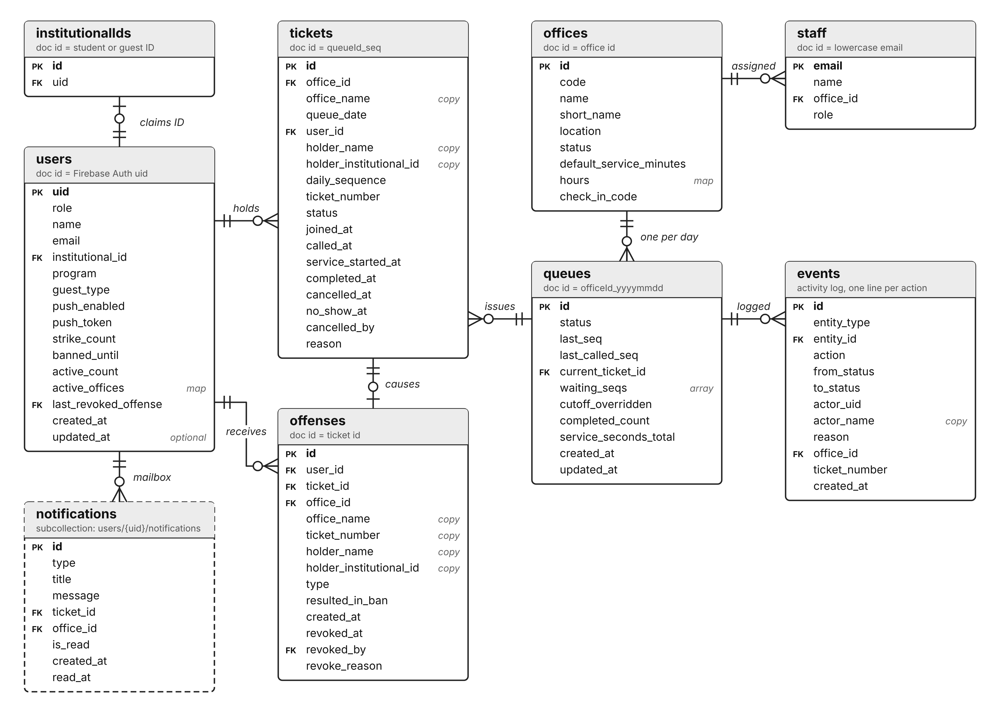
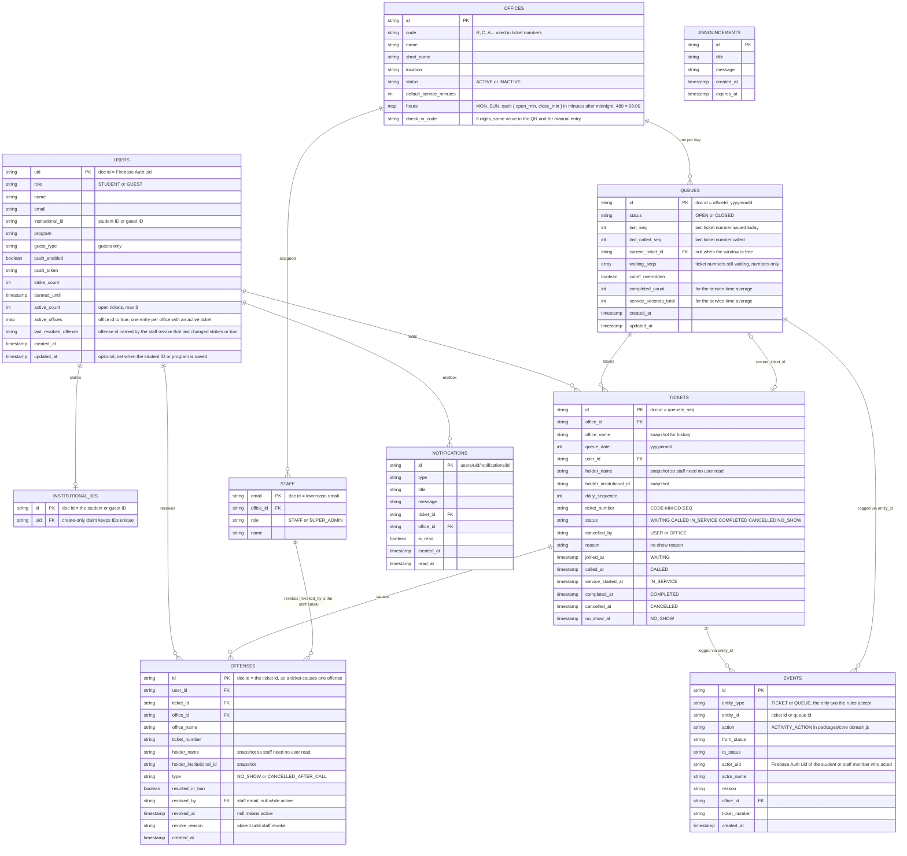

# Firestore schema (V1 draft)

Final shape for V1, locked one collection at a time. Locking a collection fixes its fields; seeding and implementation still happen per slice, not all at once.

| Collection | Status | Notes |
|---|---|---|
| `users` | **LOCKED** | |
| `institutionalIds` | **LOCKED** | claim docs `{ uid }`, create-only; implemented in slice 6.6 for students and guests |
| `offices` | **LOCKED** | keeps `short_name` and `check_in_code` |
| `staff` | **LOCKED** | |
| `queues` | **LOCKED** | |
| `tickets` | **LOCKED** | no push token and no offense fields |
| `offenses` | **LOCKED** | separate collection, not folded into tickets; implemented in slice 2 |
| `events` | **LOCKED** | activity log; create-only, one line per action, written with the change; implemented in slice 6.1 |
| `users/{uid}/notifications` | **LOCKED** | the student's mailbox; implemented in slice 6.2 |
| `announcements` | draft | finalize when implemented |

A locked collection changes only through a new entry in `docs/DECISIONS.md`.

Open items at the bottom.
Document IDs are in the comments. Everything is a Firestore document; `timestamp` fields must equal server time on write.

## Diagrams

Two pictures of this schema are drawn by `docs/erd/generate.py` (plain Python 3, no packages; run `python3 docs/erd/generate.py`, then open the SVG in a browser for a PNG):

- `docs/erd/qampus-erd-slide.svg` (and `.png`): the presentation slide, key fields only, dark theme.
- `docs/erd/qampus-erd-full.svg` (and `.png`): every field of every collection, for the paper.





When the schema changes, update the Mermaid block below, the `FIELDS` lists in `generate.py`, and the tables further down together, then run the script again.



## Reading notes
- **Ticket state ↔ timestamp** is one to one: `WAITING→joined_at`, `CALLED→called_at`, `IN_SERVICE→service_started_at`, `COMPLETED→completed_at`, `CANCELLED→cancelled_at`, `NO_SHOW→no_show_at`. "Expired" is derived (`called_at + 60 s`), not stored.
- **Waiting and position** come from `queues.waiting_seqs` (added 2026-11-06, see DECISIONS): waiting = its length, people ahead = its numbers lower than the ticket's, the display's Next = its lowest three. A join adds its number, a call or a waiting cancel removes it, an office cancel empties it. Queue docs created before the field fall back to `last_seq - last_called_seq`.
- **Not stored:** position, people ahead, estimated wait, short ticket number (`CODE-SEQ`).
- **Office timezone** is one campus constant (UTC+8) in the rules and the app, not a field.

## Value reference
Source of truth for the names is `packages/core/src/domain.js`; this is a copy so the console is not needed.

| Where | Values |
|---|---|
| `users.role` | `STUDENT`, `GUEST` |
| `staff.role` | `STAFF`, `SUPER_ADMIN` |
| `users.guest_type` | `PARENT_GUARDIAN`, `REPRESENTATIVE`, `ALUMNI`; `null` for students |
| `users.program` | a name from `packages/core/src/programs.js`; `null` for guests |
| `users.institutional_id` | student ID: seven digits (`2510048`); guest ID: `G` and six digits (`G183644`). Both are reserved as a document in `institutionalIds` |
| `offices.status` | `ACTIVE`, `INACTIVE` |
| `offices.code` | the letter or letters in ticket numbers (`M`, `R`) |
| `offices.check_in_code` | six digits, the same value in the QR code and for manual entry |
| `offices.hours` | map `MON`..`SUN`, each `{ open_min, close_min }`: whole minutes after midnight, campus time (`480` = 08:00, `1020` = 17:00) |
| `queues.status` | `OPEN`, `CLOSED` |
| `tickets.status` | `WAITING`, `CALLED`, `IN_SERVICE`, `COMPLETED`, `CANCELLED`, `NO_SHOW` |
| `tickets.cancelled_by` | `USER`, `OFFICE` |
| `offenses.type` | `NO_SHOW`, `CANCELLED_AFTER_CALL` |
| `events.entity_type` | `TICKET`, `QUEUE` |
| `events.action` | written today: `JOINED`, `CALLED`, `SERVICE_STARTED`, `COMPLETED`, `CANCELLED`, `NO_SHOW`, `OVERRIDE`, `QUEUE_OPENED`, `QUEUE_CLOSED`, `QUEUE_CANCELLED`, `CUTOFF_OVERRIDE`; defined but not written yet: `INVALID_SCAN`, `OFFENSE_RECORDED`, `OFFENSE_REVOKED` (an offense is its own document, and a revoke writes its notification but no `events` line) |
| `notifications.type` | written today: `QUEUE_CONFIRMED`, `YOUR_TURN`, `APPROACHING_TURN`, `NO_SHOW`, `WARNING` (a called ticket cancelled), `QUEUE_CANCELLED`, `OFFENSE_REVOKED`; defined but not written yet: `SERVICE_COMPLETED`, `GLOBAL_ANNOUNCEMENT` |

## Document IDs and number formats
| Collection | Document ID | Example |
|---|---|---|
| `users` | Firebase Auth uid | |
| `institutionalIds` | the student or guest ID | `2510048`, `G183644` |
| `offices` | set by hand when the office is created | `off_mds_003` |
| `staff` | lowercase email | |
| `queues` | office id + `_` + campus day `yyyymmdd` | `off_mds_003_20261105` |
| `tickets` | queue id + `_` + sequence (not padded) | `off_mds_003_20261105_1` |
| `offenses` | the ticket id | `off_mds_003_20261105_10` |
| `events`, `users/{uid}/notifications` | auto id | |

`tickets.ticket_number` is `CODE-MM-DD-SEQ` with the sequence padded to three digits (`M-11-05-001`). `tickets.queue_date` is the same day as a number (`20261105`). The campus day is UTC+8. The console shows timestamps in the viewer's time zone, so a `UTC+8` label there is the viewer's, not a stored value.

## Fields that are absent until they are set
- **`users`:** `push_token` (after the phone registers), `last_revoked_offense` (after a staff revoke changed strikes or a ban), `updated_at` (after a student ID or program is saved). `guest_type` is `null` for students and `program` is `null` for guests.
- **`tickets`:** each timestamp appears when the ticket reaches its state (`joined_at` on join, then `called_at`, `service_started_at`, `completed_at`, `cancelled_at` or `no_show_at`). `cancelled_by` comes with `cancelled_at`. `reason` is set by a no-show (optional) and by an office cancel.
- **`queues`:** `waiting_seqs` is missing on queue documents created before 2026-11-06. `current_ticket_id` is `null` while the window is free.
- **`offenses`:** created with `revoked_at: null` and `revoked_by: null`; `revoke_reason` appears when staff revoke.
- **`events` and `notifications`:** every field is always present (`null` when unused); a notification is created unread (`is_read: false`, `read_at: null`).

## Example documents (live console, 2026-11-06; names, IDs, emails and uids replaced)
```
users/{uid}                          queues/off_mds_003_20261105
  role: "STUDENT"                      status: "OPEN"
  name: "<name>"                       last_seq: 21
  email: "<school email>"              last_called_seq: 20
  institutional_id: "<7 digits>"       current_ticket_id: null
  program: "BS Data Science and        cutoff_overridden: true
           Analytics"                  completed_count: 12
  guest_type: null                     service_seconds_total: 1316
  push_enabled: true                   created_at, updated_at
  strike_count: 0                      (no waiting_seqs: created before it existed)
  banned_until: <timestamp>
  active_count: 0                    tickets/off_mds_003_20261105_1
  active_offices: { }                  status: "COMPLETED"
  last_revoked_offense:                daily_sequence: 1
    "off_mds_003_20261106_11"          ticket_number: "M-11-05-001"
                                       queue_date: 20261105
offices/off_mds_003                    office_id: "off_mds_003"
  code: "M"                            joined_at, called_at, service_started_at, completed_at
  short_name: "MDS"                    holder_name, holder_institutional_id, user_id: <redacted>
  status: "ACTIVE"
  default_service_minutes: 5         offenses/off_mds_003_20261105_10
  check_in_code: "<6 digits>"          type: "NO_SHOW"
  hours: { MON: { open_min: 480,       resulted_in_ban: false
                  close_min: 1020 },   ticket_id, user_id, revoked_by: <redacted>
          ... }                        revoked_at, revoke_reason: "Staff called an incorrect ticket number"
```
The live `staff` document has only `name`, `office_id` and `role`; `institutionalIds` documents have only `uid`; a notification has `type`, `title`, `message`, `ticket_id`, `office_id`, `is_read`, `created_at`, `read_at`.

Checked on 2026-11-06 against the live Firestore console (all nine collections and one `notifications` document) and against `firestore.rules`: field names matched, apart from the corrections made to the Mermaid block above in the same commit.

## Which slice implements what
| Slice | Collections used |
|---|---|
| 1 Ticketing | `users` (profile), `offices`, `staff`, `queues`, `tickets` |
| 2 Penalties | `offenses`, strike and ban fields on `users`, `events` |
| 3 Limits and capacity | `active_count`, queue service totals, office hours checks |
| 4 Notifications | `notifications`, `announcements`, push token fields |
| 5 Guests | `institutionalIds` claims for guests, anonymous `users` |

## Open items
1. Push: where the holder's token lives depends on the push option (relay or in-app only). If it needs a ticket field, add it by a new decision.
2. `announcements`: shape above is a draft until its slice. `notifications` is locked: every field always present; `ticket_id` and `office_id` are strings; created unread (`is_read` false, `read_at` null); the owner may only set `is_read` true and `read_at`. `events` is locked: every field is always present (null when unused); `ticket_number` is the full number (CODE-MM-DD-SEQ); `entity_id` is the ticket id or the queue id; indexes live in `firestore.indexes.json`.
